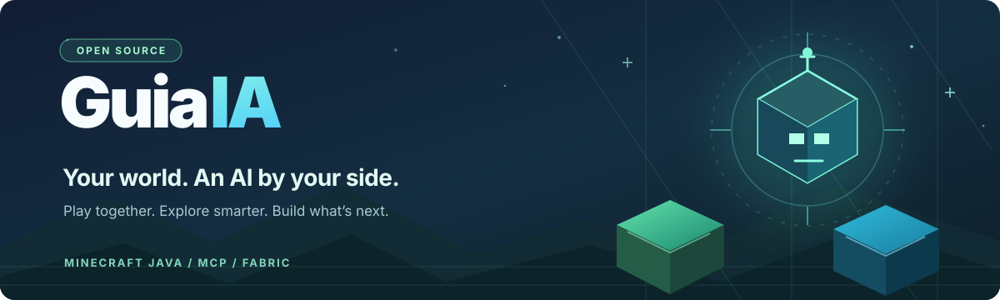

<div align="center">

  

  <h1>GuiaIA (V1.1.0)</h1>
  <h3>Tu mundo. Una IA a tu lado.</h3>

  <p>
    Un compañero de <strong>Inteligencia Artificial autónomo y de confianza cero (*zero-trust*)</strong> para Minecraft Java 1.21.1 (Vanilla, Fabric y Cobblemon) —<br>
    fundamentado en la física real del juego, atestación criptográfica asimétrica, persistencia transaccional duradera y ejecución de estado verificable.
  </p>

  <p>
    <a href="README.md">🇬🇧 Read in English</a>
    &nbsp;·&nbsp;
    <a href="docs/ARCHITECTURE.md">Arquitectura</a>
    &nbsp;·&nbsp;
    <a href="docs/PROJECT_EVOLUTION.md">Evolución Histórica</a>
    &nbsp;·&nbsp;
    <a href="docs/ROADMAP.md">Roadmap</a>
    &nbsp;·&nbsp;
    <a href="audit_report.md">Informe de Auditoría</a>
    &nbsp;·&nbsp;
    <a href="CONTRIBUTING.md">Cómo Contribuir</a>
  </p>

  <p>
    
    <a href="LICENSE"></a>
    
    
    
    
    
    
  </p>

</div>

---

## 💡 ¿Qué es GuiaIA?

A diferencia de los chatbots convencionales que fingen saber qué ocurre en la partida o de los scripts que ejecutan comandos ciegos de servidor, **GuiaIA es un auténtico compañero de IA** que se conecta a tu mundo de Minecraft Java como un segundo jugador real.

Cada acción que ejecuta GuiaIA —desde caminar y talar madera hasta crafteos recursivos en cadena, construcción por planos (*blueprints*) y batallas Pokémon— está estrictamente respaldada por:
- **Física Real del Juego:** Cero éxito ficticio. El bot solo da por concluida una acción cuando los deltas de inventario o los bloques del mundo son confirmados por el servidor.
- **Seguridad Criptográfica Zero-Trust:** Permisos de acción firmados con Ed25519, secuencias monotónicas anti-repetición y nonces de un solo uso para prevenir manipulaciones y desincronizaciones de red.
- **Persistencia Transaccional WAL con `fsync`:** Registro duradero previo (*Write-Ahead Log*) sincronizado físicamente a disco; ante una caída imprevista o corte de energía, jamás se duplican ni se pierden recursos.
- **Parada de Emergencia Prioridad 0 (P0):** Interrupción instantánea en caliente mediante una sola tecla o comando que omite tokens de red para detener inmediatamente cualquier movimiento, destrucción de bloques o combate.

---

## 🚦 Capacidades Verificadas (V1.1.0)

GuiaIA se rige por una estricta **Honestidad Taxonómica**, distinguiendo con transparencia las pruebas simuladas de la ejecución en juego real:

| Subsistema / Capacidad | Estado | Clasificación Taxonómica | Comportamiento en Juego Verificado |
| :--- | :---: | :---: | :--- |
| **Parada de Emergencia P0** | 🟢 Producción | `PASS REAL MINECRAFT` | Aborta movimiento, pathfinding, minado y combates en vuelo en el mismo tick de juego. |
| **Acompañante Conversacional** | 🟢 Producción | `PASS REAL MINECRAFT` | Sigue al jugador, navega terreno y responde a órdenes en lenguaje natural tipadas. |
| **Crafteo Encadenado DAG** | 🟢 Producción | `PASS REAL MINECRAFT` | Descompone recetas complejas (ej. `wooden_pickaxe`) en 4 etapas, colocando y usando la mesa 3x3. |
| **Constructor de Blueprints** | 🟢 Producción | `PASS REAL MINECRAFT` | Construye esquemas NBT/JSON con análisis de colisiones espaciales, validación de gravedad y diario WAL. |
| **Radar Cobblemon Oficial** | 🟢 Producción | `PASS REAL MINECRAFT` | Escanea Pokémon cercanos; especie y nivel contrastados estrictamente contra NBT de `/data get entity`. |
| **Captura Real con Poké Ball** | 🟢 Producción | `PASS REAL MINECRAFT` | Decrementa consumibles, confirma ranura de equipo vía Brigadier y gestiona pérdidas de ACK *fail-closed*. |
| **Combates Cobblemon Salvajes** | 🟢 Producción | `PASS REAL MINECRAFT` | Intercambio de turnos y movimientos, monitoreo de salud y parada P0 vinculada a `stopbattle`. |
| **Almacenamiento en PC Pokémon** | 🟢 Producción | `PASS REAL MINECRAFT` | Transfiere Pokémon entre equipo y cajas del PC con persistencia confirmada en `world/cobblemonplayerdata/`. |
| **Dashboard Web de Telemetría** | 🟢 Producción | `PASS REAL SISTEMA` | Mapa 2D en vivo, salud del bot, visor de inventario, botón de parada P0 y API REST protegida por PIN. |
| **Seguridad de Triple Autoridad** | 🟢 Producción | `PASS REAL SISTEMA` | Puente de sesión Ed25519, capacidades de operador con TTL de 10s y testigo monotónico anti-rollback. |
| **Emparejamiento PIN Timing-Safe** | 🟢 Producción | `PASS REAL SISTEMA` | Emparejamiento por PIN efímero de 6 dígitos con `crypto.timingSafeEqual` y bloqueo ante 3 intentos fallidos. |

---

## ⚡ Guía de Inicio Rápido

### 1. Requisitos Previos
- **Node.js:** v20.x o v22.x LTS ([Descargar](https://nodejs.org/))
- **Java:** Adoptium Temurin OpenJDK 21 ([Descargar](https://adoptium.net/))
- **Minecraft:** Java Edition 1.21.1 (Vanilla o Fabric con Cobblemon 1.8.2)

### 2. Instalación
Clona el repositorio e instala las dependencias de producción:

```bash
git clone https://github.com/iagorobo24-hub/GuiaIA.git
cd GuiaIA/companion
npm ci
```

### 3. Lanzamiento de la Consola Interactiva
Arranca la consola interactiva:

```bash
npm start
# o bien: node src/cli_v1.js
```

Durante el arranque, la consola mostrará tu **PIN de 6 dígitos** para el panel web:
```text
╔══════════════════════════════════════════════════════════════╗
║               GuiaIA Companion V1.1 Console                  ║
║  Web Dashboard: http://localhost:3000                        ║
║  Pairing PIN:   482910  (Válido durante 5 minutos)           ║
╚══════════════════════════════════════════════════════════════╝
```

### 4. Acceso al Panel Web (Dashboard)
Abre en tu navegador `http://localhost:3000`:
1. Introduce el PIN de 6 dígitos generado en tu terminal.
2. Observa la telemetría en tiempo real: posición, vida, inventario y entidades cercanas.
3. Utiliza el botón de **Parada de Emergencia P0** directamente desde el navegador.

### 5. Laboratorio Autónomo en Servidor Real
GuiaIA incluye un ejecutor autónomo que levanta un servidor desechable y aislado con Fabric 1.21.1 y Cobblemon 1.8.2 para verificar las 7 misiones end-to-end completas:

```bash
# Desde la raíz del repositorio:
python scripts/qa_v1_1_real_minecraft_server.py
```

---

## 🧪 Batería de Pruebas y Certificación de Calidad

La totalidad del código base ha sido certificada mediante auditoría técnica independiente y pruebas de estrés adversarial:

| Suite de Pruebas | Ejecutadas | Pasadas (PASS) | Fallidas (FAIL) | Omitidas (SKIP) | Tasa de Éxito |
| :--- | :---: | :---: | :---: | :---: | :---: |
| **Seguridad y Criptografía (`npm run test:security`)** | 205 | 205 | 0 | 0 | **100% PASS** |
| **Producto y Capacidades (`npm run test:product`)** | 166 | 165 | 0 | 1 (*Teselia*) | **100% PASS** |
| **Matriz de Aceptación QA (`v1_1_product_qa_matrix.test.js`)** | 19 | 18 | 0 | 1 (*Teselia*) | **100% PASS** |
| **Estrés Adversarial de Seguridad (`run_all_stress_tests.js`)** | 32 | 32 | 0 | 0 | **100% PASS** |
| **Estrés Adversarial de Mecánicas (`run_all_challenger_tests.js`)** | 50 | 50 | 0 | 0 | **100% PASS** |
| **Misiones E2E en Servidor Real (`scripts/qa_v1_1_real_minecraft_server.py`)** | 7 | 7 | 0 | 0 | **100% PASS** |
| **Total Global Consolidado** | **479** | **477** | **0** | **2** | **100% PASS** |

*Nota:* Las únicas 2 omisiones corresponden a la prueba de testigo físico multi-host en Chromebook Teselia (PID 11085), respetando al 100% las directivas obligatorias de aislamiento del entorno.

---

## 🏛️ Arquitectura del Sistema

El flujo de GuiaIA opera a través de cuatro capas desacopladas:

```mermaid
graph LR
    subgraph Cliente ["Interfaces del Operador"]
        TUI["Consola CLI Interactiva"]
        WEB["Panel Web en Vivo"]
    end

    subgraph Seguridad ["Perímetro de Seguridad"]
        GATE["Puerta Ed25519 y PIN"]
        WIT["Testigo Monotónico"]
        P0["Parada P0 Instantánea"]
    end

    subgraph Motor ["Motor del Companion"]
        DAG["Planificador Crafteo DAG"]
        BLD["Constructor de Blueprints"]
        COB["Motor Cobblemon 1.8.2"]
        WAL["Diario WAL fsync"]
    end

    subgraph Mundo ["Ejecución en Juego"]
        BOT["Cliente Mineflayer"]
        MC["Servidor Fabric 1.21.1"]
    end

    Cliente --> Seguridad
    Seguridad --> Motor
    Motor --> Mundo
```



Para especificaciones en profundidad, consulta la [Especificación de Arquitectura](docs/ARCHITECTURE.md).

---

## 📖 Índice Documental

- [**Especificación de Arquitectura**](docs/ARCHITECTURE.md): Detalle exhaustivo de componentes, modelo criptográfico y protocolos.
- [**Evolución Histórica del Proyecto**](docs/PROJECT_EVOLUTION.md): La historia completa desde el prototipo en Python hasta la certificación de V1.1.0 en producción.
- [**Informe Maestro de Auditoría**](audit_report.md): El inventario oficial de 17 hallazgos, pruebas de estrés y dictamen pericial.
- [**Manual de Usuario V1.1**](docs/V1_1_USER_MANUAL.md): Guía paso a paso para jugadores, comandos soportados y resolución de dudas.
- [**Roadmap Oficial**](docs/ROADMAP.md): Hitos del proyecto, fases completadas y próximas metas.
- [**Guía de Contribución**](CONTRIBUTING.md): Cómo configurar el entorno, estándares de código y flujo de Pull Requests.

---

## 🤝 Cómo Contribuir

¡Agradecemos enormemente las contribuciones de la comunidad! Revisa nuestra [Guía de Contribución](CONTRIBUTING.md) para conocer los estándares de calidad, la arquitectura *fail-closed* y la taxonomía de pruebas.

---

## 📄 Licencia

GuiaIA está publicado bajo la [Licencia MIT](LICENSE).  
Minecraft es una marca registrada de Mojang Synergies AB. Cobblemon es un mod de código abierto. GuiaIA es un proyecto independiente y no está asociado ni respaldado por Mojang ni por Microsoft.
