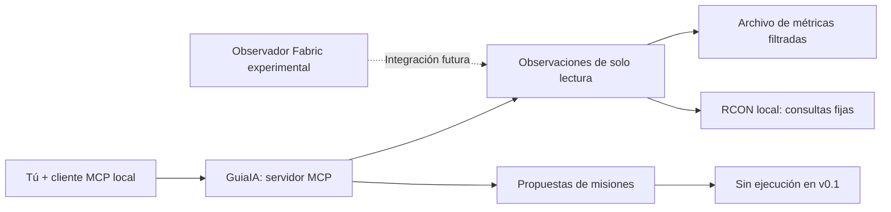

<div align="center">
  

  <h3>¿Y si Minecraft fuera un mundo que pudieras compartir con una IA?</h3>

  <p>
    Un proyecto de código abierto para crear un <strong>compañero IA que juegue contigo</strong><br>
    y agentes capaces de <strong>observar, comprender y mejorar</strong> el mundo que construyes.
  </p>

  <p>
    <a href="README.md">🇬🇧 Read in English</a>
    &nbsp;·&nbsp;
    <a href="docs/ROADMAP.md">Hoja de ruta</a>
    &nbsp;·&nbsp;
    <a href="https://github.com/iagorobo24-hub/GuiaIA/discussions">Comunidad</a>
    &nbsp;·&nbsp;
    <a href="CONTRIBUTING.md">Colaborar</a>
  </p>

  <p>
    <a href="https://github.com/iagorobo24-hub/GuiaIA/actions/workflows/ci.yml"></a>
    <a href="https://github.com/iagorobo24-hub/GuiaIA/releases/tag/v0.1.0-alpha"></a>
    <a href="LICENSE"></a>
    
    
  </p>
</div>

> [!IMPORTANT]
> **GuiaIA está en desarrollo: todavía NO es un compañero autónomo listo para jugar.** La rama pública **main** ofrece un servidor MCP de solo lectura, consultas básicas de Minecraft, propuestas de misiones sin ejecución y comprobaciones de seguridad. El bot que juega a tu lado, la visión real del mundo y el agente de desarrollo autónomo son las siguientes fases. Queremos mostrar avances comprobados, no fingir una demostración.

---

## ✨ Una idea: jugar con alguien que también sea IA

Imagina abrir Minecraft y decirle a tu compañero:

> «GuiaIA, acompáñame a explorar esta cueva».
>
> «Vamos a construir una base. Ayúdame a conseguir los materiales».
>
> «Aquí el servidor va lento. ¿Puedes investigar la causa y probar una solución sin poner en riesgo nuestro mundo?».

La idea no es un chatbot que se inventa lo que ocurre, ni un agente que ejecuta comandos sin control. Queremos una IA que **juegue de verdad**, que **sepa qué está pasando gracias a datos reales** y que también pueda **desarrollar, probar y verificar mejoras** en mundos de laboratorio.

**Esos ejemplos son nuestra visión, no funciones que ya estén disponibles.**

<table>
  <tr>
    <td width="33%" valign="top">
      <h3>🧭 Tu compañero</h3>
      <p><strong>Modo jugador — planificado</strong></p>
      <p>Seguirte, explorar, recolectar, construir y vivir aventuras contigo.</p>
      <a href="https://github.com/iagorobo24-hub/GuiaIA/issues/2">Desarrollo del compañero →</a>
    </td>
    <td width="33%" valign="top">
      <h3>👁️ Sus ojos</h3>
      <p><strong>Observador — experimental</strong></p>
      <p>Que la IA reciba información real, limitada y verificable del mundo.</p>
      <a href="https://github.com/iagorobo24-hub/GuiaIA/issues/1">World Observer →</a>
    </td>
    <td width="33%" valign="top">
      <h3>🛠️ Tu desarrollador</h3>
      <p><strong>Agente técnico — prototipo</strong></p>
      <p>Investigar problemas, preparar pruebas y verificar soluciones antes de aplicarlas.</p>
      <a href="https://github.com/iagorobo24-hub/GuiaIA/issues/3">Agente desarrollador →</a>
    </td>
  </tr>
</table>

## 🚦 ¿Qué funciona realmente?

| Funcionalidad | Estado | Qué hace hoy |
| :-- | :-- | :-- |
| 🟢 Servidor MCP local | **Disponible** | Cuatro herramientas tipadas accesibles desde un cliente MCP mediante stdio |
| 🟢 Estado del servidor | **Disponible** | Consulta jugadores conectados y tiempo de juego con comandos RCON fijos en local |
| 🟢 Diagnóstico de rendimiento | **Disponible** | Analiza métricas autorizadas y propone comprobaciones, sin realizar cambios |
| 🟢 Planificador de misiones | **Disponible** | Entiende peticiones limitadas de recolección y crea propuestas; **no las ejecuta** |
| 🟡 World Observer para Fabric | **Rama experimental** | Mod para observar una muestra limitada de chunks cargados; compila, pero **faltan pruebas reales dentro del juego** |
| ⚪ Compañero jugable | **Planificado** | Seguir, explorar, recolectar, sobrevivir y construir |
| ⚪ Desarrollo automático de Minecraft | **Planificado** | Agentes capaces de probar soluciones en entornos aislados |
| ⚪ Visión por capturas | **Planificado** | Capturas reales del cliente con permiso y control de privacidad |

La versión actual de Python **no requiere GPU ni contratar una IA de pago**. La [rama experimental de Fabric](https://github.com/iagorobo24-hub/GuiaIA/tree/feature/world-observer-p0) está separada de la [versión alfa publicada](https://github.com/iagorobo24-hub/GuiaIA/releases/tag/v0.1.0-alpha).

## ⚡ Pruébalo tú mismo

No necesitas tener Minecraft instalado ni introducir ninguna API key. Solo **Python 3.11 o posterior y Git**.

```bash
git clone https://github.com/iagorobo24-hub/GuiaIA.git
cd GuiaIA

# Prueba un diagnóstico con datos ficticios incluidos en el repositorio
PYTHONPATH=src python3 - <<'PY'
import json
from guiaia.observer import SnapshotObserver
from guiaia.tools import ToolRegistry

tools = ToolRegistry(SnapshotObserver("examples/synthetic_world.json"))
print(json.dumps(tools.invoke("guia_diagnose", {}), indent=2))
PY
```

Verás un informe estructurado que indica posibles problemas de tiempo por tick, TPS y entidades cargadas, junto a propuestas de diagnóstico. Verás también `"production_changes": 0`, porque la herramienta **no modifica el servidor**. Los valores de este ejemplo son **sintéticos**.

Para conectarlo a un cliente compatible con MCP:

```bash
PYTHONPATH=src python3 -m guiaia.mcp --snapshot examples/synthetic_world.json
```

El proceso queda esperando mensajes MCP por entrada/salida estándar. **No abre una aplicación gráfica ni crea un jugador de Minecraft.** Consulta la [configuración de clientes MCP](docs/MCP_USAGE.md).

<details>
<summary><strong>🔌 Conectar un servidor Minecraft Java propio</strong></summary>

Para servidores autorizados, con RCON accesible **exclusivamente en el equipo local**, el adaptador permite únicamente los comandos de consulta `list` y `time query gametime`.

```bash
PYTHONPATH=src python3 -m guiaia.mcp \
  --rcon-password-file /ruta/privada/absoluta/rcon.secret \
  --rcon-port 25575
```

RCON debe estar configurado previamente. No expongas RCON a internet ni pegues contraseñas en chats de IA. Esta conexión básica **no puede ver bloques, mobs, capturas ni el TPS real**. Utiliza un servidor de pruebas para cualquier experimento.

</details>

<details>
<summary><strong>🧰 Herramientas MCP que ya están disponibles en main</strong></summary>

| Herramienta | Resultado | ¿Modifica el mundo? |
| --- | --- | :---: |
| `guia_status` | Jugadores conectados y tiempo de juego, sin nombres | No |
| `guia_performance` | Métricas disponibles o ausencia explícita de datos | No |
| `guia_diagnose` | Diagnóstico orientativo y pruebas propuestas | No |
| `guia_plan_gather` | Propuesta de recolección limitada, sin ejecutar | No |

La rama experimental añade `guia_world_observe`; **no está incluida en la versión alfa**.

</details>

## 🏗️ Primero observar. Después actuar.



El criterio de seguridad para el futuro es:

**Observar → planificar → comprobar permisos → probar en un mundo aislado → verificar → pedir autorización antes de tocar producción.**

Un modelo de IA **nunca** debe poder ejecutar por sí solo comandos arbitrarios, scripts o modificaciones sobre el mundo sin autorización independiente. [Arquitectura](docs/ARCHITECTURE.md) · [Seguridad](SECURITY.md).

## 🗺️ Próximas fases

| Fase | Objetivo | Seguimiento |
| --- | --- | --- |
| **01 · Entender el mundo** | Leer bloques, entidades y eventos reales, con límites de seguridad | [#1](https://github.com/iagorobo24-hub/GuiaIA/issues/1) |
| **02 · Jugar contigo** | Bot que te acompaña, recoge recursos y verifica inventarios | [#2](https://github.com/iagorobo24-hub/GuiaIA/issues/2) |
| **03 · Agentes de desarrollo** | Diagnosticar errores, probar soluciones y medir resultados | [#3](https://github.com/iagorobo24-hub/GuiaIA/issues/3) |
| **04 · Ver como un jugador** | Capturas del cliente reales y autorizadas | [#4](https://github.com/iagorobo24-hub/GuiaIA/issues/4) |
| **05 · Beta comunitaria** | Instalación sencilla y pruebas con jugadores reales | [#5](https://github.com/iagorobo24-hub/GuiaIA/issues/5) |

El primer objetivo para Fabric es **Minecraft Java 1.21.1**. La compatibilidad con otros Minecraft y modpacks habrá que comprobarla. Puedes consultar la [hoja de ruta detallada](docs/ROADMAP.md), el [prototipo Fabric](https://github.com/iagorobo24-hub/GuiaIA/tree/feature/world-observer-p0/fabric-observer) y los [repositorios relacionados investigados](docs/RESEARCH.md).

## 🤝 ¿Te apuntas a construirlo?

**GuiaIA es público desde sus primeras fases. Queremos ideas, jugadores, programadores y personas que prueben lo que desarrollamos.**

| Si te interesa… | Entra aquí |
| --- | --- |
| ⭐ La idea del proyecto | **[Dale una estrella al repositorio](https://github.com/iagorobo24-hub/GuiaIA)** para ayudar a que más gente lo descubra |
| 💬 Decidir qué hará el compañero | [Cuéntanos tu idea en Discussions](https://github.com/iagorobo24-hub/GuiaIA/discussions) |
| 🧑‍💻 Programar bots, Fabric o agentes | [Elige una tarea](https://github.com/iagorobo24-hub/GuiaIA/issues) y lee [CONTRIBUTING.md](CONTRIBUTING.md) |
| 🧪 Probar funciones experimentales | [Ejecuta las pruebas](CONTRIBUTING.md) y reporta errores reproducibles |
| 🎮 Jugar con el compañero cuando esté listo | [Sigue las versiones publicadas](https://github.com/iagorobo24-hub/GuiaIA/releases) |

<details>
<summary><strong>Pruebas para desarrolladores</strong></summary>

```bash
PYTHONPATH=src python3 -m unittest discover -s tests -v
python3 -m compileall -q src tests
```

GitHub Actions prueba el paquete Python con las versiones 3.11, 3.12 y 3.13. El mod Fabric tiene un [proceso de compilación aislado](https://github.com/iagorobo24-hub/GuiaIA/actions/workflows/fabric.yml), pero aún no ha completado una prueba real dentro del juego.

No subas mundos privados, datos de jugadores, contraseñas, direcciones de servidores ni archivos de mods de terceros sin permiso. Los agentes capaces de modificar mundos necesitarán validaciones y autorización independientes.

</details>

---

<div align="center">
  <strong>Un mundo por explorar. Un compañero por crear.</strong><br>
  <sub>Código abierto · <a href="LICENSE">Licencia MIT</a> · <a href="README.md">English</a> · <a href="SECURITY.md">Seguridad</a></sub><br>
  <sub>Proyecto comunitario independiente, sin afiliación ni respaldo de Mojang, Microsoft o Cobblemon.</sub>
</div>
