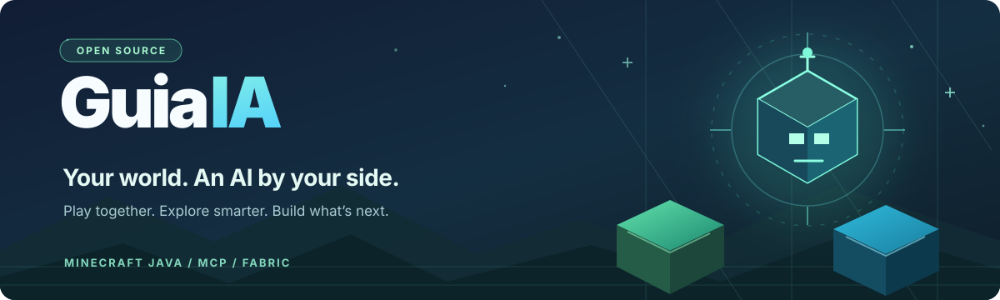
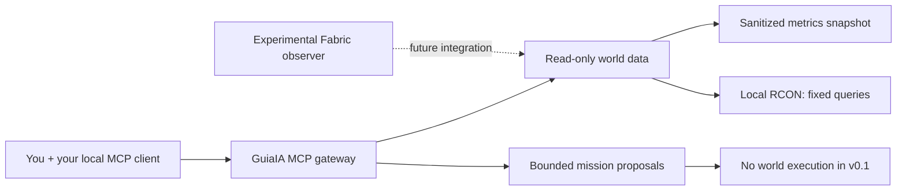

<div align="center">
  

  <h3>What if Minecraft felt like a world you could share with an AI?</h3>

  <p>
    An open-source project to build a real <strong>AI companion</strong> for Minecraft —<br>
    and the tools for AI agents to <strong>observe, understand and improve</strong> the worlds we play in.
  </p>

  <p>
    <a href="README.es.md">🇪🇸 Leer en español</a>
    &nbsp;·&nbsp;
    <a href="docs/ROADMAP.md">Roadmap</a>
    &nbsp;·&nbsp;
    <a href="https://github.com/iagorobo24-hub/GuiaIA/discussions">Join the conversation</a>
    &nbsp;·&nbsp;
    <a href="CONTRIBUTING.md">Contribute</a>
  </p>

  <p>
    <a href="https://github.com/iagorobo24-hub/GuiaIA/actions/workflows/ci.yml"></a>
    <a href="https://github.com/iagorobo24-hub/GuiaIA/releases/tag/v0.1.0-alpha"></a>
    <a href="LICENSE"></a>
    
    
  </p>
</div>

> [!IMPORTANT]
> **This is an early developer preview, not a playable AI companion yet.** The public **main** branch provides a working read-only MCP gateway, local Minecraft status queries, deterministic mission proposals and safety checks. The in-game companion, world vision and autonomous development workflows are **in development**. We would rather show what's real than fake an impressive demo.

---

## ✨ The vision

**One world. Two players. One of them is AI.**

Imagine telling your companion:

> “GuiaIA, come explore this cave with me.”
>
> “Help me collect the materials for our base.”
>
> “Why is this area lagging? Investigate it and test a fix safely.”

Not a chatbot pretending it can see Minecraft. Not an agent blindly sending server commands. The goal is a companion that can **act inside the game**, grounded in **real observations**, while a separate development agent can **test and improve your world** without risking your saves.

These examples describe **where we're going**, not gameplay already shipped.

<table>
  <tr>
    <td width="33%" valign="top">
      <h3>🧭 Play together</h3>
      <p><strong>Companion mode — planned</strong></p>
      <p>Follow, explore, gather, build and experience Minecraft alongside a real player.</p>
      <a href="https://github.com/iagorobo24-hub/GuiaIA/issues/2">Help build the companion →</a>
    </td>
    <td width="33%" valign="top">
      <h3>👁️ See the world</h3>
      <p><strong>World Observer — experimental</strong></p>
      <p>Give AI tools trusted, bounded information about the actual world rather than guesses.</p>
      <a href="https://github.com/iagorobo24-hub/GuiaIA/issues/1">Explore the observer →</a>
    </td>
    <td width="33%" valign="top">
      <h3>🛠️ Improve the world</h3>
      <p><strong>Developer Agent — early prototype</strong></p>
      <p>Diagnose lag, design test plans and eventually verify improvements in isolated worlds.</p>
      <a href="https://github.com/iagorobo24-hub/GuiaIA/issues/3">Shape the developer agent →</a>
    </td>
  </tr>
</table>

## 🚦 What actually works today?

| Capability | Status | What it really does |
| :-- | :-- | :-- |
| 🟢 Local MCP gateway | **Available** | Exposes four typed tools to a compatible MCP client over stdio |
| 🟢 Minecraft server status | **Available** | Reads online player counts and game time using fixed, loopback-only Java RCON queries |
| 🟢 Performance analysis | **Available** | Reads an authorized metrics snapshot and proposes a diagnostic path — no automatic fix |
| 🟢 Safe mission planning | **Available** | Parses bounded gather requests into proposals; **never executes them** |
| 🟡 Fabric World Observer | **Experimental branch** | Compiled 1.21.1 prototype for aggregate loaded-chunk observations; **real in-game QA still required** |
| ⚪ Playable AI companion | **Planned** | Following, exploration, gathering, survival and building |
| ⚪ Automated Minecraft development | **Planned** | Agent-driven QA, code changes, before/after verification and controlled promotion |
| ⚪ Screenshot-based vision | **Planned** | Real opt-in client screenshots with provenance and privacy controls |

The current Python preview has **no paid AI dependency**, runs without a GPU and does not install mods or touch a world save. The Fabric prototype lives separately in [`feature/world-observer-p0`](https://github.com/iagorobo24-hub/GuiaIA/tree/feature/world-observer-p0); it is **not part of the current alpha release**.

## ⚡ Try it in 60 seconds

**No Minecraft server, API key, game account or AI subscription needed.** Just Python 3.11+ and Git.

```bash
git clone https://github.com/iagorobo24-hub/GuiaIA.git
cd GuiaIA

# Run a real diagnostic against the included synthetic example
PYTHONPATH=src python3 - <<'PY'
import json
from guiaia.observer import SnapshotObserver
from guiaia.tools import ToolRegistry

tools = ToolRegistry(SnapshotObserver("examples/synthetic_world.json"))
print(json.dumps(tools.invoke("guia_diagnose", {}), indent=2))
PY
```

**You'll get a structured diagnosis**, including the observed tick-time warning, low reported TPS, high entity count, and suggested checks — with `"production_changes": 0`. The sample is **synthetic**, not a claim about a real server.

Want to connect it to your AI client? Start the **MCP stdio server**:

```bash
PYTHONPATH=src python3 -m guiaia.mcp --snapshot examples/synthetic_world.json
```

This command waits for an MCP client on stdin/stdout; it does **not** launch a graphical app or a Minecraft bot. See the [MCP client setup and smoke test](docs/MCP_USAGE.md).

<details>
<summary><strong>🔌 Connect to a Minecraft Java server you operate</strong></summary>

This optional mode only reads **`list`** and **`time query gametime`** via Minecraft Java RCON bound to `127.0.0.1`:

```bash
PYTHONPATH=src python3 -m guiaia.mcp \
  --rcon-password-file /absolute/private/path/rcon.secret \
  --rcon-port 25575
```

RCON must already be enabled on a **trusted local machine**. Keep passwords in protected files, never paste them into an AI chat, and never expose RCON to the internet. This adapter does not provide game vision, nearby entities or trustworthy live TPS. Do **not** experiment on a valued multiplayer server.

</details>

<details>
<summary><strong>🧩 Which MCP tools are currently shipped on main?</strong></summary>

| Tool | Result | World changes? |
| --- | --- | :---: |
| `guia_status` | Sanitized player count / game tick status | No |
| `guia_performance` | Available performance metrics or explicit missing values | No |
| `guia_diagnose` | Evidence and suggested debugging steps | No |
| `guia_plan_gather` | A bounded, non-executing gather plan | No |

The experimental Fabric branch also adds `guia_world_observe`, which is **not in the alpha release**.

</details>

## 🏗️ Designed to observe before it acts



Our long-term rule is straightforward:

**Observe → plan → check permissions → test in an isolated world → verify → request approval before production changes.**

Model output is **never** permission to run arbitrary RCON commands, execute shell code or modify someone's world. [Read the architecture](docs/ARCHITECTURE.md) · [Security model](SECURITY.md).

## 🗺️ Roadmap: from tools to a teammate

| Milestone | What we're building | Track it |
| --- | --- | --- |
| **01 · World awareness** | Real loaded-chunk/entity observations, provenance and server budgets | [#1](https://github.com/iagorobo24-hub/GuiaIA/issues/1) |
| **02 · A companion you can play with** | Real in-game follow, stop, gather and inventory verification | [#2](https://github.com/iagorobo24-hub/GuiaIA/issues/2) |
| **03 · Agentic world development** | Diagnose lag, reproduce problems in QA and verify proposed improvements | [#3](https://github.com/iagorobo24-hub/GuiaIA/issues/3) |
| **04 · Real vision** | Opt-in screenshots and visual confirmation | [#4](https://github.com/iagorobo24-hub/GuiaIA/issues/4) |
| **05 · Community beta** | Easy install, real gameplay demo and external testing | [#5](https://github.com/iagorobo24-hub/GuiaIA/issues/5) |

The first target for the Fabric side is **Minecraft Java 1.21.1**. Compatibility with other versions and modpacks must be verified, not assumed. Find the full [development plan](docs/ROADMAP.md), [Fabric prototype](https://github.com/iagorobo24-hub/GuiaIA/tree/feature/world-observer-p0/fabric-observer), and [research into related projects](docs/RESEARCH.md).

## 🤝 Help us make this real

**We're building in public — and early contributors can genuinely shape what GuiaIA becomes.**

| If you… | Start here |
| --- | --- |
| 💚 Like the idea | **[Star the repository](https://github.com/iagorobo24-hub/GuiaIA)** to help others discover it |
| 💬 Have a gameplay idea | [Tell us what you'd ask your AI companion to do](https://github.com/iagorobo24-hub/GuiaIA/discussions) |
| 🧑‍💻 Build Minecraft mods or agents | [Pick a roadmap issue](https://github.com/iagorobo24-hub/GuiaIA/issues) and read [CONTRIBUTING.md](CONTRIBUTING.md) |
| 🧪 Enjoy breaking things safely | [Run the tests](CONTRIBUTING.md) and report a reproducible bug |
| 🎮 Just want to play with it | [Watch the releases](https://github.com/iagorobo24-hub/GuiaIA/releases) for a **real gameplay beta** |

<details>
<summary><strong>Developer commands, safety and supported environment</strong></summary>

```bash
PYTHONPATH=src python3 -m unittest discover -s tests -v
python3 -m compileall -q src tests
```

GitHub Actions tests the Python package on Python 3.11, 3.12 and 3.13. The standalone Fabric observer has its own [isolated build workflow](https://github.com/iagorobo24-hub/GuiaIA/actions/workflows/fabric.yml) on the experimental branch, using Java 21. The observer has **not** completed an in-game integration test.

Please do not submit private saves, player details, server addresses, credentials, or third-party mod assets. State-changing agent capabilities will require isolated QA and explicit operator authorization.

</details>

---

<div align="center">
  <strong>A world worth exploring. A teammate worth building.</strong><br>
  <sub>Open source under the <a href="LICENSE">MIT License</a> · <a href="README.es.md">Español</a> · <a href="SECURITY.md">Security</a></sub><br>
  <sub>Independent community project. Not affiliated with or endorsed by Mojang, Microsoft or Cobblemon.</sub>
</div>
