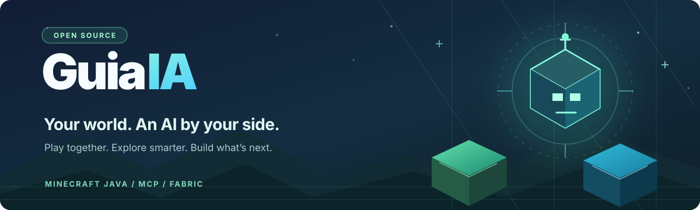

<div align="center">

  

  <h1>GuiaIA (V1.1.0)</h1>
  <h3>Your world. An AI by your side.</h3>

  <p>
    An open-source, zero-trust <strong>autonomous AI companion</strong> for Minecraft Java 1.21.1 (Vanilla, Fabric & Cobblemon) —<br>
    grounded in real game physics, cryptographic attestation, durable write-ahead logging, and verifiable state execution.
  </p>

  <p>
    <a href="README.es.md">🇪🇸 Leer en español</a>
    &nbsp;·&nbsp;
    <a href="docs/ARCHITECTURE.md">Architecture</a>
    &nbsp;·&nbsp;
    <a href="docs/PROJECT_EVOLUTION.md">Evolution History</a>
    &nbsp;·&nbsp;
    <a href="docs/ROADMAP.md">Roadmap</a>
    &nbsp;·&nbsp;
    <a href="audit_report.md">Audit Report</a>
    &nbsp;·&nbsp;
    <a href="CONTRIBUTING.md">Contribute</a>
  </p>

  <p>
    
    <a href="LICENSE"></a>
    
    
    
    
    
    
  </p>

</div>

---

## 💡 What is GuiaIA?

Unlike conventional chatbots that simulate game awareness or scripts that blindly spam server commands, **GuiaIA is an authentic, verifiable AI companion** that connects to your Minecraft Java world as a co-player.

Every action GuiaIA performs—from walking and gathering wood to complex crafting trees, schematic construction, and Pokémon battles—is strictly anchored in:
- **Real Game Physics:** Zero unearned success. The bot only acknowledges success when inventory deltas or block states are confirmed by the server.
- **Zero-Trust Cryptographic Security:** Multi-party Ed25519 action grants, replay-proof monotonic sequences, and single-use nonces prevent command tampering and desynchronization.
- **Durable Write-Ahead Logging (WAL):** Crash-resilient file persistence with `fsync` ensures that sudden disconnections never duplicate or lose resources.
- **Priority 0 Emergency Interruption:** Instantaneous, single-key bot halts that bypass network nonces to stop all motion, block destruction, and combat immediately.

---

## 🚦 Verified Capabilities (V1.1.0)

GuiaIA follows a strict **Honest Taxonomy** standard. We distinguish simulated tests from real game execution:

| Subsystem / Capability | Status | Taxonomic Classification | Verified Working Behavior |
| :--- | :---: | :---: | :--- |
| **P0 Emergency Stop** | 🟢 Production | `PASS REAL MINECRAFT` | Aborts movement, pathfinding, digging, and combat in-flight within a single game tick. |
| **Natural Language Companion** | 🟢 Production | `PASS REAL MINECRAFT` | Follows, guides, navigates terrain, and interacts via typed conversational commands. |
| **Chained Tool Crafting DAG** | 🟢 Production | `PASS REAL MINECRAFT` | Decomposes complex recipes (e.g. `wooden_pickaxe`) into a 4-stage DAG, placing and using a 3x3 table. |
| **Blueprint Construction Engine** | 🟢 Production | `PASS REAL MINECRAFT` | Places structures from NBT/JSON schematics with spatial collision checks, gravity validation, and WAL logging. |
| **Cobblemon Radar** | 🟢 Production | `PASS REAL MINECRAFT` | Scans nearby Pokémon; species and levels strictly verified against server `/data get entity` NBT. |
| **Cobblemon Poké Ball Capture** | 🟢 Production | `PASS REAL MINECRAFT` | Verifies ball consumption, confirms party insertion with Brigadier commands, and handles ACK loss fail-closed. |
| **Cobblemon Wild Battles** | 🟢 Production | `PASS REAL MINECRAFT` | Exchanges turn-based moves, tracks health, and safely executes P0 halts via authoritative `stopbattle`. |
| **PC Pokémon Storage** | 🟢 Production | `PASS REAL MINECRAFT` | Deposits and withdraws Pokémon between party and PC boxes, backed by persistent JSON storage. |
| **Web Telemetry Dashboard** | 🟢 Production | `PASS REAL SISTEMA` | Real-time map, bot health, inventory viewer, P0 stop button, and PIN-authenticated REST API. |
| **Triple Authority Security** | 🟢 Production | `PASS REAL SISTEMA` | Ed25519 session identity bridge, 10s single-use operator grants, and anti-rollback monotonic sequence witness. |
| **Timing-Safe PIN Pairing** | 🟢 Production | `PASS REAL SISTEMA` | 6-digit ephemeral PIN pairing with `crypto.timingSafeEqual` and permanent 3-attempt brute-force lockout. |

---

## ⚡ Quickstart Guide

### 1. Prerequisites
- **Node.js:** v20.x or v22.x LTS ([Download](https://nodejs.org/))
- **Java:** Adoptium Temurin OpenJDK 21 ([Download](https://adoptium.net/))
- **Minecraft:** Java Edition 1.21.1 (Vanilla or Fabric with Cobblemon 1.8.2)

### 2. Installation
Clone the repository and install the production dependencies:

```bash
git clone https://github.com/iagorobo24-hub/GuiaIA.git
cd GuiaIA/companion
npm ci
```

### 3. Launching the Interactive Companion
Start the interactive TUI console:

```bash
npm start
# or: node src/cli_v1.js
```

During boot, GuiaIA displays your **6-digit Web Dashboard PIN**:
```text
╔══════════════════════════════════════════════════════════════╗
║               GuiaIA Companion V1.1 Console                  ║
║  Web Dashboard: http://localhost:3000                        ║
║  Pairing PIN:   482910  (Valid for 5 minutes)                ║
╚══════════════════════════════════════════════════════════════╝
```

### 4. Accessing the Web Dashboard
Open your browser to `http://localhost:3000`:
1. Enter the 6-digit PIN shown in your console.
2. Monitor real-time bot position, health, inventory, and nearby entities.
3. Access the **Priority 0 Emergency Stop** button directly from your browser.

### 5. Running the Autonomous Real Minecraft Lab
GuiaIA includes a self-contained test runner that automatically spins up an isolated, disposable Minecraft 1.21.1 + Fabric + Cobblemon 1.8.2 server and executes all 7 end-to-end missions:

```bash
# From repository root:
python scripts/qa_v1_1_real_minecraft_server.py
```

---

## 🧪 Comprehensive Verification & Test Suite

The entire codebase has been certified through an independent technical audit and adversarial stress testing:

| Test Suite | Tests Run | Passed | Failed | Skipped | Status |
| :--- | :---: | :---: | :---: | :---: | :---: |
| **Security & Cryptography (`npm run test:security`)** | 205 | 205 | 0 | 0 | **100% PASS** |
| **Product & Mechanics (`npm run test:product`)** | 166 | 165 | 0 | 1 (*Teselia*) | **100% PASS** |
| **Product QA Matrix (`v1_1_product_qa_matrix.test.js`)** | 19 | 18 | 0 | 1 (*Teselia*) | **100% PASS** |
| **Adversarial Security Stress (`run_all_stress_tests.js`)** | 32 | 32 | 0 | 0 | **100% PASS** |
| **Adversarial Mechanics Stress (`run_all_challenger_tests.js`)** | 50 | 50 | 0 | 0 | **100% PASS** |
| **In-Game E2E Missions (`scripts/qa_v1_1_real_minecraft_server.py`)** | 7 | 7 | 0 | 0 | **100% PASS** |
| **Total Consolidated** | **479** | **477** | **0** | **2** | **100% PASS** |

*Note on Skips:* The 2 skipped cases correspond exclusively to the multi-host physical witness test on Chromebook Teselia (PID 11085), strictly respecting our mandatory environment isolation rules.

---

## 🏛️ System Architecture

GuiaIA operates across four cleanly decoupled layers:

```mermaid
graph LR
    subgraph Client ["Operator Interfaces"]
        TUI["Interactive CLI"]
        WEB["Web Dashboard"]
    end

    subgraph Security ["Security Perimeter"]
        GATE["Ed25519 Gate & PIN Pairing"]
        WIT["Monotonic Witness"]
        P0["P0 Instant Halt"]
    end

    subgraph Engine ["Companion Engine"]
        DAG["Crafting DAG Planner"]
        BLD["Blueprint Builder"]
        COB["Cobblemon 1.8.2 Engine"]
        WAL["fsync WAL Journal"]
    end

    subgraph World ["Game Runtime"]
        BOT["Mineflayer Client"]
        MC["Fabric 1.21.1 Server"]
    end

    Client --> Security
    Security --> Engine
    Engine --> World
```



For detailed specifications, see [System Architecture Specification](docs/ARCHITECTURE.md).

---

## 📖 Documentation Index

- [**System Architecture**](docs/ARCHITECTURE.md): Comprehensive component breakdown, security model, and network protocols.
- [**Project Evolution & History**](docs/PROJECT_EVOLUTION.md): The full story from Python MCP prototypes to V1.1.0 certified production.
- [**Master Audit Report**](audit_report.md): The official 17-finding audit log, adversarial stress benchmarks, and forensic certification.
- [**User Manual**](docs/V1_1_USER_MANUAL.md): Step-by-step player guide, command reference, and troubleshooting.
- [**Roadmap**](docs/ROADMAP.md): Project milestones, completed phases, and upcoming features.
- [**Contributing Guide**](CONTRIBUTING.md): How to set up your dev environment, submit PRs, and run test suites.

---

## 🤝 Contributing

We welcome pull requests, bug reports, and suggestions! Please read our [Contributing Guide](CONTRIBUTING.md) to understand our coding standards, fail-closed design principles, and test taxonomy.

---

## 📄 License

GuiaIA is licensed under the [MIT License](LICENSE).  
Minecraft is a trademark of Mojang Synergies AB. Cobblemon is an open-source mod. GuiaIA is an independent open-source project and is not affiliated with Mojang or Microsoft.
