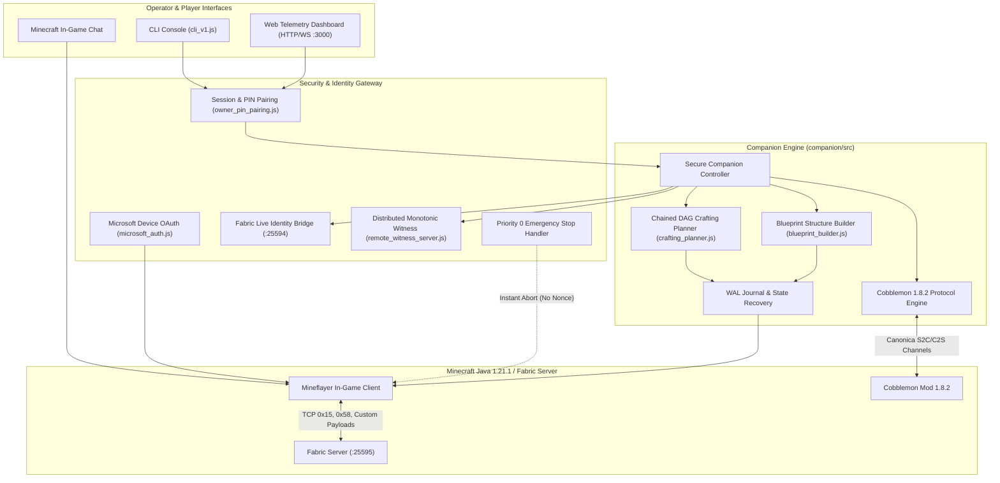

# GuiaIA System Architecture Specification

> **Specification Version:** 1.1.0  
> **Status:** Approved for Production  
> **Target Environment:** Minecraft Java 1.21.1, Fabric Loader 0.16.9+, Cobblemon 1.8.2+, Node.js v20+, Python 3.11+  
> **Last Verification Date:** November 3, 2026  

---

## 1. High-Level System Topology

GuiaIA is designed as a distributed, defense-in-depth architecture. The system cleanly separates player intent, cryptographic authority, state execution, and world observation.



---

## 2. Security Architecture & Zero-Trust State Execution

State modification in GuiaIA is governed by the principle of **Zero-Trust**: no action is taken based on unverified assumptions or client-side claims.

### 2.1 Priority 0 Emergency Stop (Fail-Safe Channel)
- **Bypass of Heavy Cryptography:** In emergency scenarios (e.g. lava hazards, hostile mob swarms, accidental structure damage), requiring a cryptographic nonce reservation would introduce dangerous latency.
- **Immediate Interruption:** Commands like `"¡Alto!"`, `"Stop"`, `"Detente"` or the Web Dashboard emergency button immediately execute:
  1. `pathfinder.setGoal(null)` to abort navigation.
  2. `bot.stopDigging()` to cancel active block destruction.
  3. `bot.clearControlStates()` to release all movement keys.
  4. Authoritative battle termination (`stopbattle <player>`) if in a Cobblemon fight.
  5. Reset of active task states to `idle` or `emergency_halted`.

### 2.2 The Triple Authority Verification Chain
Before any physical world mutation occurs (harvesting blocks, chest transfers, building placement):
1. **Server Identity Bridge (Ed25519):** Verifies that the player is currently online on the server thread by challenging the Fabric identity bridge on port `25594`.
2. **Operator Capability Grant:** A single-use, time-bounded (10s TTL) Ed25519 token scoped to the exact target block coordinates, item ID, and quantity.
3. **Monotonic Sequence Checkpoint (Anti-Replay / Anti-Rollback):** A distributed monotonic witness validates that the incoming sequence number strictly increments ($seq_{new} = seq_{current} + 1$). Replay of spent nonces or attempted rollbacks to earlier backup states are rejected with `ROLLBACK_DETECTED`.

### 2.3 Timing-Safe Ephemeral PIN Authentication
For local or LAN operations, the bot generates a cryptographically random 6-digit numeric PIN with a 5-minute Time-To-Live (TTL):
- **Timing-Attack Immunity:** String comparisons are performed using `crypto.timingSafeEqual` over fixed-width byte buffers.
- **Brute-Force Lockout:** After 3 consecutive incorrect PIN attempts, the session permanently transitions to HTTP 403 Forbidden until a full process restart.

---

## 3. Core Engine Subsystems

### 3.1 Chained Tool Crafting DAG Engine (`crafting_planner.js`)
Crafting in Minecraft often involves recursive dependencies. The Crafting Planner decomposes arbitrary crafting targets into a Directed Acyclic Graph (DAG):
- **Recursive Decomposition:** Automatically resolves prerequisites (e.g., Target: `wooden_pickaxe` $\rightarrow$ requires 3 `oak_planks` and 2 `stick` $\rightarrow$ requires `oak_log` $\rightarrow$ requires placing a `crafting_table`).
- **3x3 Table Lifecycle:** Detects whether a 3x3 crafting station is required, checks existing inventory for a crafting table, or schedules the crafting, placement, interaction, and recovery of one.
- **Inventory Delta Verification:** Crafting steps require physical inventory confirmation before the next DAG stage is scheduled.

### 3.2 Blueprint Structure Placement Engine (`blueprint_builder.js`)
Enables automated, verifiable construction from schematic blueprints:
- **Spatial Preflight & Collision Analysis:** Inspects target bounding boxes to ensure the bot or player will not be suffocated or trapped.
- **Gravity-Aware Placement:** Identifies gravity-affected blocks (sand, gravel, concrete powder). If no supporting block exists beneath, the operation fails-closed with `{ ok: false, reason: 'gravity_unsupported' }` rather than letting blocks fall into inconsistent positions.
- **Write-Ahead Journaling:** Every placed block is recorded to disk with SHA-256 checksums and `fsync`. In the event of a crash, the engine compares the world state (`bot.blockAt`) against the journal to resume without re-placing or skipping blocks.

### 3.3 Canonical Cobblemon 1.8.2 Protocol Engine
GuiaIA interfaces with the official Fabric Cobblemon mod through verified network channels:
- **DataComponentTypes Sanitization (Minecraft 1.21.1):** Strips custom item components (>56) from packet `0x15` (`set_slot`) to prevent `node-minecraft-protocol` deserializer crashes while accurately updating inventory counts.
- **Radar Entity Synchronization:** Extracts real-time species, level, and UUID from `PokemonEntity.class` DataTrackers, verified against server NBT via `/data get entity`.
- **Poké Ball Capture Protocol:** Tracks physical ball consumption, verifies party/PC slot insertion using official Brigadier commands (`testpartyslot`), and handles lost ACKs fail-closed without blind re-throws.
- **Turn-Based Battle Adapter:** Dispatches moves using polymorphic action models and supports safe in-flight emergency halts via `stopbattle`.
- **PC Storage Controller:** Manages box-to-party transfers, backed by verifiable JSON persistence in `world/cobblemonplayerdata/`.

### 3.4 Web Telemetry & Dashboard Subsystem (`web/server.js`)
A lightweight, zero-dependency Node.js HTTP/WebSocket server:
- **Real-Time Telemetry:** Broadcasts bot health, coordinates, yaw/pitch, inventory contents, and nearby entities.
- **Secure Endpoints:** `/api/status`, `/api/emergency-stop`, `/api/inventory` protected by Bearer token authentication derived from the paired PIN.
- **Content Security Policy (CSP):** Strict headers prohibiting inline script injection or unauthorized external domains.

---

## 4. Testability & The Disposable Laboratory Harness

GuiaIA enforces a strict testing hierarchy across 4 tiers:

```text
Tier A: Unit & Contract Tests (Node.js test runner)
Tier B: Mock Integration Tests (Simulated world & network buffers)
Tier C: Multi-Process OS Tests (Forked child processes, real disk fsync, TCP loopback)
Tier D: Real Disposable Minecraft Laboratory (Fabric 1.21.1 + Cobblemon 1.8.2 on Durán)
```

The disposable test runner (`scripts/qa_v1_1_real_minecraft_server.py`):
1. Creates an isolated temporary directory (`guiaia-v1-1-disposable-*`).
2. Configures a dedicated server on port 25595 with a local command bridge on port 25599.
3. Automatically sets `eula=true`, `online-mode=false`, `simulation-distance=3`.
4. Executes the test script (`companion/test/qa_v1_1_real_minecraft_e2e.js`).
5. Shuts down cleanly via stdin `stop` command and releases all network sockets.

---

## 5. Architectural Invariants

1. **Fail-Closed by Default:** Any parsing failure, network timeout, corrupted state file, or missing signature halts execution safely.
2. **Zero Synthetic Success:** A bot never claims to have mined, built, caught, or deposited an item without physical confirmation from server packets or inventory deltas.
3. **Honest Provenance:** Test assertions never mock production codepaths and claim they ran on real Minecraft.
4. **Environment Isolation:** Zero interference with external networks, multi-host endpoints, or production saves.
