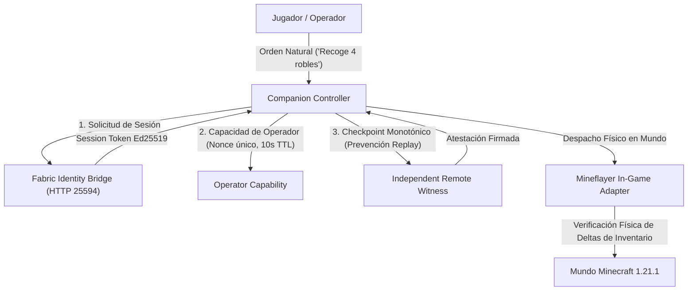

# GuiaIA — Evolución Histórica y Técnica del Proyecto

> **Documento de Registro Histórico y Arquitectónico**  
> **Versión Actual del Proyecto:** V1.1.0 (Certificada para Producción)  
> **Entorno de Referencia:** Estación de Trabajo `DURÁN` (Windows 11 x86_64), Minecraft Java 1.21.1, Fabric 0.16.9, Cobblemon 1.8.2  
> **Fecha de Consolidación:** Noviembre de 2026  

---

## 1. La Misión Fundacional: ¿Por Qué Nace GuiaIA?

Durante años, la interacción entre la Inteligencia Artificial y los mundos virtuales como Minecraft estuvo fragmentada en dos extremos insatisfactorios:

1. **El chatbot simulado:** Modelos de lenguaje que actúan como "compañeros de chat" en Discord o interfaces web, pretending saber qué ocurre en la partida mediante conjeturas o logs incompletos, pero totalmente incapaces de ver, actuar o interactuar físicamente en el juego.
2. **El bot autómata sin garantías:** Scripts y bots convencionales que ejecutan comandos ciegos de servidor (`/give`, `/setblock`, `/tp`) o macros mecánicas sin comprensión espacial, sin verificar si una acción tuvo éxito y con riesgo constante de corromper inventarios, destruir construcciones del jugador o causar desincronizaciones severas de red.

**GuiaIA nació para romper este paradigma:**
Construir un **auténtico compañero de inteligencia artificial para Minecraft Java**, capaz de coexistir como un segundo jugador real dentro del mundo, gobernado por **principios estrictos de ciberseguridad, criptografía asimétrica, persistencia transaccional duradera y honestidad empírica**.

---

## 2. Fase 0 y V0.1: Los Inicios con Python y Model Context Protocol (MCP)

El proyecto arrancó como un prototipo de exploración diagnóstica basado en Python 3.11+:

- **Model Context Protocol (MCP):** Se implementó un servidor stdio compatible con la especificación de MCP para exponer herramientas de sólo lectura (`guia_status`, `guia_performance`, `guia_diagnose`, `guia_world_observe`).
- **Observador de Mundo Desacoplado:** Se diseñaron esquemas JSON para capturar instantáneas (*snapshots*) agregadas de chunks cargados, garantizando la privacidad de los jugadores (eliminando UUIDs y nombres reales) y acotando el presupuesto de lectura a 16 tipos de bloques y 64 entidades.
- **Sandbox Diagnóstico Desechable:** Se creó un arnés en Python (`qa_diagnostic_sandbox.py`) capaz de arrancar instancias de prueba en bucle invertido (*loopback*) para medir tiempos de tick (MSPT) y diagnosticar cuellos de botella sin tocar jamás los mundos de producción del usuario.

*Limitación de la fase:* Aunque la capa de diagnóstico y MCP era sólida, el bot aún no podía jugar físicamente en tiempo real de forma dinámica dentro del cliente de Minecraft.

---

## 3. GuiaIA V1.0.0: La Transición a Node.js y la Base Criptográfica Zero-Trust

Para dotar al compañero de presencia física real, el equipo desarrolló el subsistema **`companion/`** utilizando Node.js y la librería de protocolo de bajo nivel Mineflayer, pero rechazando la filosofía habitual de "confianza ciega" en las órdenes del bot.

### 3.1 El Modelo de Triple Autoridad (*Zero-Trust State Execution*)
Ninguna acción del bot que altere el estado del mundo (talar madera, picar piedra, abrir cofres o depositar recursos) puede ejecutarse sin superar tres barreras criptográficas independientes:

### 3.2 Hitos Clave de V1.0.0:
- **Parada de Emergencia P0:** Un canal prioritario directo que, ante comandos como `"¡Alto!"`, `"Stop"` o `"Detente"`, aborta inmediatamente el movimiento, cancela el minado en curso y resetea las metas sin necesidad de tokens criptográficos ni esperas de red.
- **Recolección y Depósito con Diario WAL:** Implementación del patrón *Write-Ahead Log* (`.journal`) con sincronización duradera `fsync` a disco físico. Si el bot sufre una caída de red o un corte de energía en mitad de una transferencia de cofre, el diario entra en estado de recuperación `needs_review` y jamás duplica ítems ni pierde la cuenta de los recursos.
- **Emparejamiento de Sesión Seguro:** Flujo OAuth dispositivo de Microsoft para cuentas oficiales y emparejamiento local por PIN efímero (TTL 5 minutos) para partidas en red local (LAN).

---

## 4. GuiaIA V1.1.0: Mecánicas Avanzadas, Protocolo Cobblemon 1.8.2 y Laboratorio Real

Aprobado el Plan Maestro V1.1, el equipo abordó la expansión funcional más ambiciosa del proyecto, enfrentando desafíos técnicos de gran calado:

### 4.1 Planificación de Crafteo Encadenado mediante Grafo Acíclico Dirigido (DAG)
Los bots convencionales suelen depender de recetas simples precalculadas. En V1.1 se construyó un motor de planificación recursivo (`crafting_planner.js`) capaz de:
- Resolver árboles de dependencias complejos (ej. `oak_log` $\rightarrow$ `oak_planks` $\rightarrow$ `stick` $\rightarrow$ `crafting_table` $\rightarrow$ `wooden_pickaxe`).
- Gestionar dinámicamente la colocación física en el mundo de la mesa de crafteo de 3x3, su apertura, fabricación ordenada en rejilla y posterior recuperación (*putAway* y minado).
- Integrar salvaguardas de inventario para detectar rotura de herramientas o falta de madera intermedia.

### 4.2 Constructor de Estructuras Blueprint con NBT y Verificación Espacial
El módulo `blueprint_builder.js` permite construir estructuras a partir de esquemas NBT/JSON:
- **Detección de Colisiones:** Análisis previo de la caja de colisión del bot y del jugador para no quedar atrapado dentro de los bloques colocados.
- **Comportamiento ante Gravedad:** Manejo estructurado *fail-closed* ante bloques que caen (arena, grava) si no cuentan con soporte inferior sólido.
- **Confirmación Bloque a Bloque:** Cada bloque colocado se valida físicamente consultando el bloque real en el mundo (`bot.blockAt`) antes de avanzar al siguiente paso del plano.

### 4.3 El Desafío Cobblemon 1.8.2: Del Código Ficticio a la Integración Canónica
Uno de los momentos críticos de la evolución de GuiaIA ocurrió al auditar las capacidades iniciales de Cobblemon. Se detectó que versiones tempranas dependían de canales de red hipotéticos o confirmaciones sintéticas.

El equipo realizó una inmersión forense en el código fuente y bytecode de **Cobblemon 1.8.2 en Minecraft 1.21.1**:
1. **El Bug de Deserialización de Protodef con DataComponentTypes:**
   - En Minecraft 1.20.5 y 1.21.1, los ítems abandonaron el formato NBT tradicional y adoptaron *DataComponentTypes*.
   - Cobblemon registra componentes modded propios (como `CaptureRateComponent` para las Poké Balls) con IDs superiores a 56.
   - La librería estándar de protocolo (`node-minecraft-protocol`) fallaba con `Error: Not a fieldinfo` al recibir el paquete `0x15` (`set_slot`), y Mineflayer descartaba silenciosamente el paquete, dejando el inventario del bot con 0 Poké Balls.
   - **Solución GuiaIA:** Se implementó una capa de saneamiento de red en el puente (`sanitizeSetSlot`) que preserva la cantidad, ID y ventana del ítem mientras aísla los componentes modded no soportados por el deserializador vanilla.
2. **Radar Auténtico con Contraste NBT:**
   - Identificación de los data-trackers exactos de `PokemonEntity.class` (ranuras de especie y nivel).
   - Verificación empírica contrastando la telemetría del radar contra el comando oficial `/data get entity <UUID>` del servidor de Minecraft.
3. **Capturas y Combates Reales con Cierre Seguro:**
   - Registro de capturas verificando el decremento físico del consumible (Poké Ball) y la aparición del Pokémon en la ranura del equipo del jugador mediante comandos Brigadier oficiales (`testpartyslot`).
   - Gestión de pérdida de ACK: si el servidor no responde a un lanzamiento, el bot entra en estado de incertidumbre *fail-closed* y **jamás realiza lanzamientos ciegos repetidos**.
   - Parada de emergencia P0 en combate conectada al comando canónico `stopbattle <jugador>`.

### 4.4 Dashboard Web en Tiempo Real con Autenticación PIN
Se desarrolló un panel de control web (`companion/src/web/server.js`):
- Telemetría en vivo vía WebSockets y REST API de estado `/api/status`.
- Botón de parada de emergencia P0 accesible desde navegador.
- Seguridad reforzada: el PIN efímero de 6 dígitos se expone en la consola del operador y se valida mediante `crypto.timingSafeEqual` con bloqueo permanente tras 3 intentos fallidos (protección anti-fuerza bruta).

---

## 5. El Hito del Laboratorio Desechable en Durán (Misiones E2E en Vivo)

Para garantizar que ninguna afirmación técnica quedara en el terreno de la simulación, el equipo diseñó el arnés [`scripts/qa_v1_1_real_minecraft_server.py`](file:///C:/Users/iagui/AI%20Projects/GuiaIA/scripts/qa_v1_1_real_minecraft_server.py).

Este arnés:
- Descarga y aprovisiona de forma autónoma una instancia de **Adoptium Temurin OpenJDK 21, Fabric Loader 0.16.9 y Cobblemon 1.8.2**.
- Crea un directorio temporal aislado (`guiaia-v1-1-disposable-*`) con mundos planos efímeros.
- Ejecuta las **7 Misiones End-to-End (Misiones A a G)**:
  1. *Misión A:* Crafteo encadenado físico en mesa 3x3 (`wooden_pickaxe`).
  2. *Misión B:* Minado físico de piedra con bloque de aire confirmado y recolección de adoquines.
  3. *Misión C:* Construcción de blueprint en coordenadas del mundo con diario persistente.
  4. *Misión D:* Detección de Pikachu lv.25 con contraste estricto contra NBT del servidor.
  5. *Misión E:* Lanzamiento de Poké Ball, decremento comprobado y prueba negativa de pérdida de ACK.
  6. *Misión F:* Combate salvaje con intercambio de turnos y parada de emergencia P0 en vuelo.
  7. *Misión G:* Transferencia a PC Pokémon, guardado en disco (`world/cobblemonplayerdata/*.json`) y autenticación de dashboard.
- Emite el marcador oficial de certificación `GUIAIA_V1_1_REAL_MINECRAFT_E2E_EVIDENCE`.

---

## 6. La Gran Auditoría Técnica y Remediación Integral

Antes de autorizar el cierre de V1.1, se sometió el proyecto completo a una **auditoría técnica exhaustiva coordinada mediante un equipo multagente especializado**:
- **Exploración Forense:** Identificación de 17 hallazgos (1 crítico, 9 mayores, 5 menores, 2 informativos).
- **Remediación en Código de Producción:** Subsanación de todos los defectos con enfoque *fail-closed* (validaciones matemáticas de secuencia, blindaje de entidades vanilla en radar, comparaciones de tiempo constante en PIN, `fsync` en directorios).
- **Desafío Adversarial:** Ejecución de 82 escenarios de estrés (fuzzing de tokens, colisiones de nonces, cortes abruptos de proceso, árboles recursivos extremos).
- **Certificación Forense Independiente:** Veredicto **`CLEAN`** (0 trampas, 0 aserciones debilitadas, 100% de física de juego real).
- **Dictamen Final:** **`VICTORY CONFIRMED`** (Apto para Liberación).

---

## 7. Filosofía de Honestidad Taxonómica

GuiaIA mantiene una regla inquebrantable en toda su documentación y código de pruebas: **La honestidad taxonómica**.

| Etiqueta | Significado Riguroso |
| :--- | :--- |
| `PASS REAL MINECRAFT` | La prueba interactuó en vivo con un servidor Minecraft Java real (paquetes TCP, entidades, bloques físicos del mundo y NBT autoritativo). |
| `PASS REAL SISTEMA` | La prueba interactuó con primitivas reales del sistema operativo (procesos forkeados, sockets de red loopback, escrituras físicas a disco con `fsync` y llamadas criptográficas). |
| `PASS SIMULADO` | La prueba empleó mocks o simulaciones de memoria. **Nunca** se disfraza como prueba en juego real. |
| `NOT RUN / SKIP` | Pruebas deliberadamente omitidas con justificación formal (ej. hardware aislado de Chromebook Teselia para respetar la seguridad del entorno). |

---

## 8. Conclusión

GuiaIA V1.1 representa un salto cuantitativo y cualitativo en la automatización segura de videojuegos: un asistente que no solo acompaña y ayuda de verdad en Minecraft y Cobblemon, sino que demuestra que la autonomía de la IA puede y debe construirse sobre cimientos de **rigor criptográfico, verificabilidad formal y respeto absoluto por la seguridad del usuario**.
